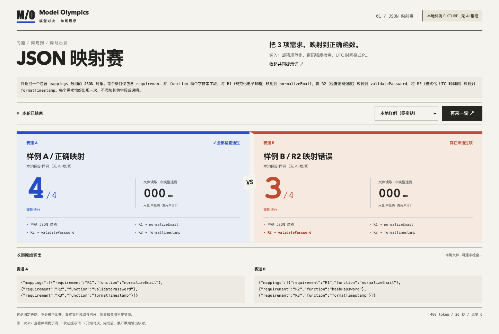
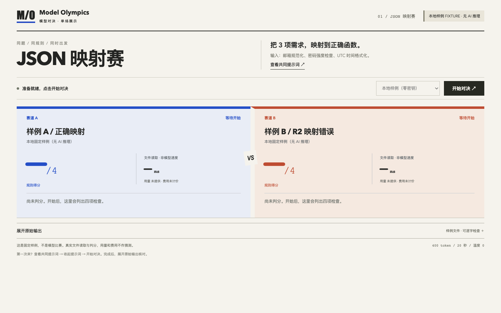

# Model Olympics · 模型对决

同一道 JSON 映射题，两条赛道同时开始，用同一套规则检查结果。

默认无需密钥：读取两份本地固定样例，展示正确映射的 **4/4** 与一处错误的 **3/4**。
你可以展开原始输出，看到每一分为什么通过或失败，也可以配置两个真实模型参与对决。



## 快速开始

需要 Node.js **^22.12.0 || ^24.0.0 || >=26.0.0** 和 npm；不支持 Node 23/25。
进入项目目录，依次运行：

```sh
npm run setup
npm run doctor
npm run dev
```

打开 [本地页面](http://127.0.0.1:4206)，保持终端运行。
前端使用 4206 端口，后端使用 5206 端口，均仅监听本机。

`setup` 按锁文件安装依赖，并准备浏览器测试所需的 Chromium、FFmpeg；首次安装需要网络。
缓存保存在项目内，也可只读复用已有 macOS 浏览器缓存。Linux 需自行具备浏览器系统依赖。
`doctor` 检查版本、依赖和端口，遇到问题会给出中文恢复提示。

## 体验一场对决

1. 点击 **查看共同提示词**，了解邮箱规范化、密码强度检查和 UTC 时间格式化三个需求。
2. 点击 **开始对决**，比较两路得分与逐项检查。
3. 点击 **展开原始输出**：样例 B 将 R2 写成了 `hashPassword`，正确映射应为 `validatePassword`。

点击 **再来一轮** 可重复运行。以下是开始前的页面；两张截图均来自实际运行的应用。



本地模式始终标注 **FIXTURE · 无 AI 推理**。样例耗时是文件读取与处理耗时，不能比较模型速度。
没有 usage 数据时显示“未提供”，费用显示“未计价”。

## 可选：接入真实模型

将 `.env.example` 复制为 `.env`，填写以下配置：

| 配置 | 含义 |
| --- | --- |
| `OPENAI_API_KEY` | 服务密钥，仅由后端读取 |
| `OPENAI_BASE_URL` | 可信的 OpenAI 兼容 API 地址 |
| `MODEL_A` / `MODEL_B` | 同一接口支持的两个不同模型 ID |

重启 `npm run dev`，在运行模式中选择真实模型。
模型需支持 Chat Completions、`temperature: 0` 和 `max_tokens: 400`。
选项可用仅表示配置齐全；请求失败会直接显示错误，不会切换成样例结果。

每轮并发发出两次请求，不重试；每路最多 400 输出 token，20 秒超时，同时只接受一轮。
真实调用可能收费，token 和超时限制不构成费用上限。项目不估算费用，也不执行生成代码。

## 验证

先在开发终端按 Ctrl+C 停止服务，再运行：

```sh
npm run build
npm run test
npm run e2e
npm run demo
npm run doctor
```

构建、7 项单测、3 项浏览器测试和独立演示已通过，详见 [status.json](status.json)。
测试覆盖判分、并发、超时、错误处理、键盘操作及 390px 小屏布局。
`demo` 会生成真实操作录像，保存在 `artifacts/playwright/demo/`；日志与录像不提交 Git。

## 能力边界

这是单题、单次的结构化输出展示，不是科学模型排名。四项得分来自严格 JSON 结构和三个精确映射；Markdown 代码围栏不算合法 JSON。
不包含账户、持久历史、多轮采样、流式 token 展示或代码执行。开发服务仅适用于本机可信环境。

当前状态为 **PARTIAL**：本地样例闭环已验证，真实推理未验证。
验证环境为 macOS Apple Silicon、Node.js 26.4.0，复用已有浏览器组件；Windows/Linux、最低 Node 版本及全新机器浏览器下载未实机验证。

采用 [MIT 许可证](LICENSE)。
